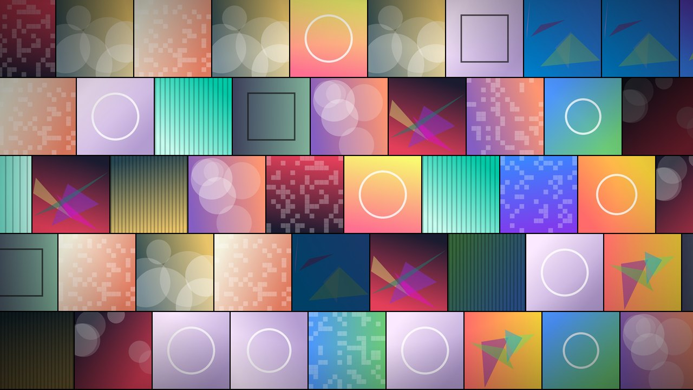
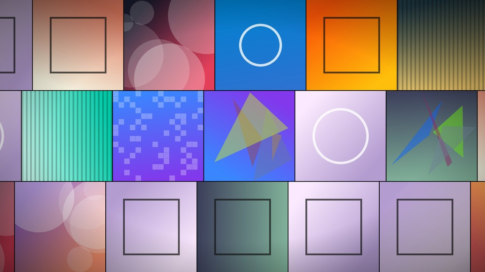

# Album Wall

**A Windows screensaver that turns your screen into a slowly drifting wall of album covers.**

Point it at a folder of cover art and it fills the screen with rows of covers. Each row glides sideways, neighbouring rows move in opposite directions at slightly different speeds, and every few seconds one cover flips over to reveal a different album. It's built to be calm background motion for a desk or a TV, inspired by the classic album-artwork screensavers.





*Previews use made-up placeholder covers. On your own computer it shows the artwork from your own folder.*

> **Personal use only.** This is a personal project, shared so people can see how it works. You may read the code and build it for your own personal use. Please don't redistribute it or use it commercially. See [LICENSE](LICENSE).

## Features

- **Your own covers.** Any folder of `.jpg`, `.jpeg`, `.png` or `.bmp` images, subfolders included. It starts with your Music folder.
- **Adjustable.** 2 to 10 rows, at slow, medium or fast speed.
- **Covers flip.** Every few seconds a cover turns over to show another album.
- **Multi-monitor.** Works full screen on every monitor, and in the little preview box in Windows' Screen Saver Settings.
- **Easy to exit.** Any key or mouse movement closes it, like every screensaver.
- **Tiny.** One small file, no installer, nothing extra to download.

## Build

No extra software is needed. It compiles with the C# compiler that ships with Windows (.NET Framework 4):

```bat
build.cmd
```

This produces `AlbumWall.scr`.

> Windows Defender sometimes flags small programs you compile yourself as "potentially unwanted", because they aren't signed. If that happens, the code is all here in `AlbumWall.cs` to read.

## Install

1. Right-click `AlbumWall.scr` and choose **Install**. You can also copy it to `C:\Windows\System32` and pick it in Screen Saver Settings.
2. Click **Settings…** to choose your folder of covers, the number of rows and the speed.

## How it works

A `.scr` file is an ordinary Windows program that the system starts with one of these arguments:

| Argument | What happens |
|---|---|
| `/s` | Runs full screen |
| `/p <hwnd>` | Draws inside the preview box in Screen Saver Settings |
| `/c` (or none) | Opens the settings window |
| `/snapshot <file.png>` | Renders one frame to an image, for testing |

Settings are saved in the registry under `HKEY_CURRENT_USER\Software\AlbumWall`. Covers are loaded on a background thread and scaled down once, so the wall stays smooth even with large folders.

Built with C#, WPF and Windows Forms on .NET Framework 4.

## License

Copyright © 2026 Zeek Dmello. All rights reserved. Free for personal, non-commercial use; see [LICENSE](LICENSE).
